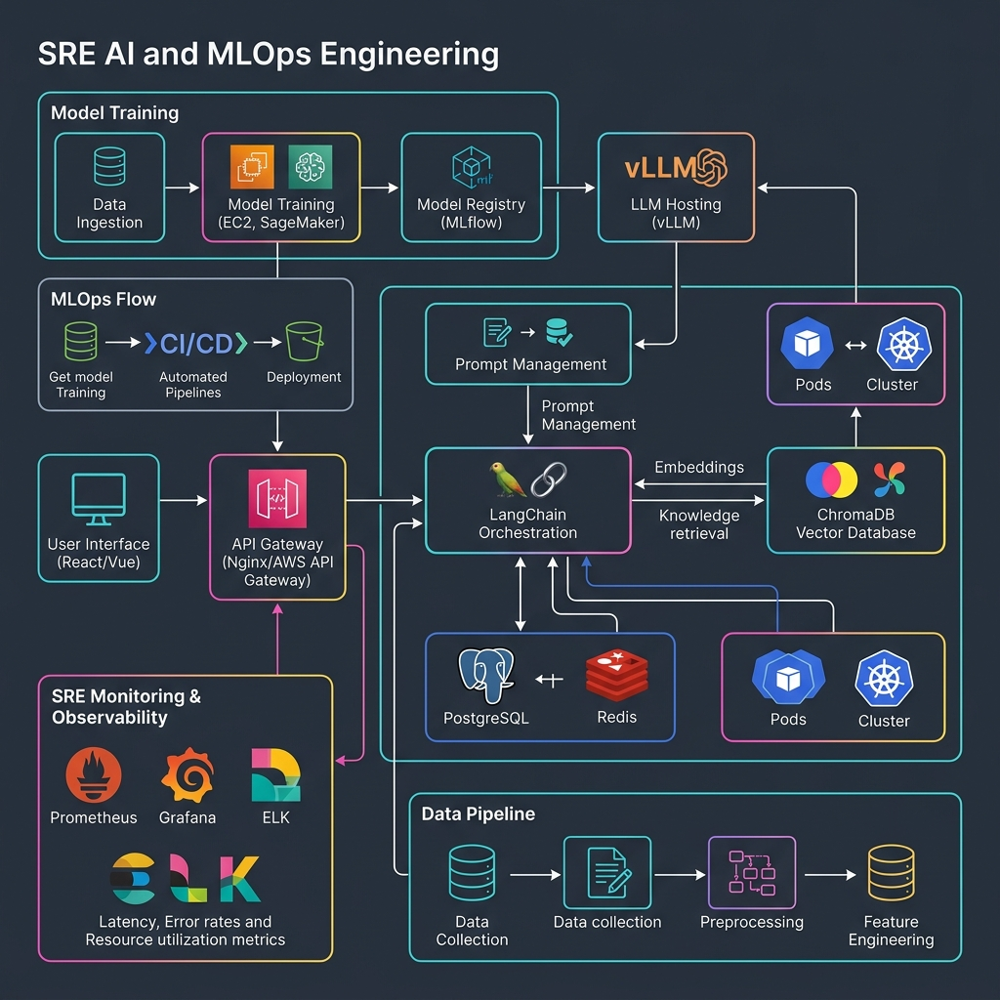
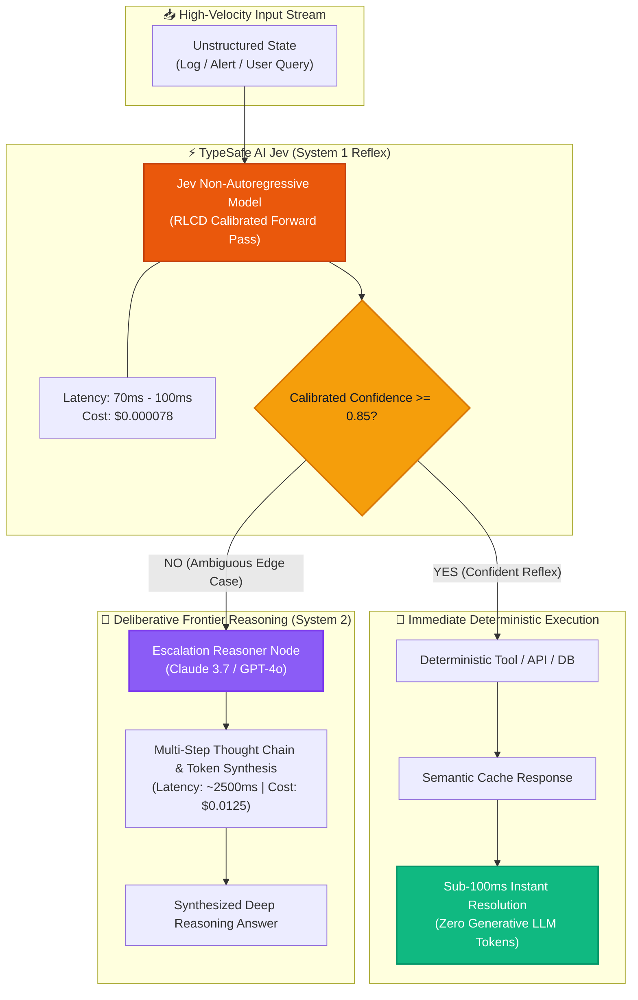

# ⚡ TypeSafe Jev: System 1 AI Studio (`tp-typesafe-jev`)

> High-Throughput Sub-100ms Non-Autoregressive Decision Engine & Dual-Process AI Architecture

[](LICENSE)
[](https://talaripradeep.info/tools/)
[](https://talaripradeep.info/tools/jev-system1/)
[](https://typesafe.ai)
[](https://talaripradeep.info/tools/jev-system1/)

---

### ⚖️ Legal & Architectural Attribution
*This repository contains enterprise-grade SRE blueprints, integration middleware, and cognitive orchestration templates for **TypeSafe AI's Jev model** (founded by former OpenAI researcher Diogo Almeida, released September 15, 2026). References to third-party frameworks, models, or trademarks (including TypeSafe AI, Anthropic Claude, OpenAI, LangGraph, Kubernetes, and Fastify) are for interoperability, architectural patterns, and educational purposes.*

---

## ⚡ Executive Overview

**Jev** is the industry's first specialized **System 1 artificial intelligence model**, implementing Daniel Kahneman's Dual-Process Cognitive Theory (*Thinking, Fast and Slow*) in cloud-native software stacks:

*   **System 1 (Jev · Fast & Reflexive):** Evaluates unstructured state (alerts, customer tickets, API payloads, telemetry streams) in a **single non-autoregressive forward pass** (70ms – 150ms P99) directly into typed, schema-constrained outputs with calibrated confidence probabilities (**RLCD**).
*   **System 2 (Frontier LLMs · Slow & Deliberative):** Deliberates open-ended reasoning, multi-step thought synthesis, and prose generation (2,000ms – 15,000ms+ on Claude 3.7 / GPT-4o / o3).

By placing **Jev as the System 1 reflex gatekeeper**, systems eliminate **90% to 98% of unnecessary frontier LLM invocations**, slashing token costs from ~$0.0125 down to **$0.000078 per decision** while ensuring sub-100ms customer P95 latencies.

---

## 🛠️ Interactive Developer Studio

Test, benchmark, and simulate Jev live in your browser:
👉 **[Launch Interactive TypeSafe Jev Studio](https://talaripradeep.info/tools/jev-system1/)**

*   **Real-time Reflex Simulator:** Benchmark latency, calibrated confidence meters, and cost savings on real payloads.
*   **4 Production Scenarios:** Agent Reflex Router, SRE Outage & Log Triage, Zero-Latency Prompt Injection Guardrail, and FinOps Cloud Anomaly.
*   **Multi-Engine Code Exporters:** Python Pydantic v2, TypeScript Zod v3, LangGraph StateGraph, and Kubernetes gRPC sidecar manifests.

---

## 🏗️ Architecture Flow Diagram





---

## 🚀 Quickstart & Usage

### 1. Prerequisites
- Python 3.10+ or Node.js 18+
- Docker & Kubernetes (for sidecar deployment)
- TypeSafe AI API Key or Local gRPC Socket

### 2. Installation
```bash
git clone https://github.com/Pradeeptalari14/tp-typesafe-jev.git
cd tp-typesafe-jev
pip install -r requirements.txt
```

### 3. Run Python Client (`primary_config/jev_client.py`)
```bash
python primary_config/jev_client.py
```

### 4. Deploy Kubernetes Low-Latency IPC Sidecar
```bash
kubectl apply -f primary_config/k8s-jev-sidecar.yaml
kubectl get pods -n ai-platform -l app.kubernetes.io/name=jev-system1-engine
```

### 5. Validate Environment & SRE Compliance
```bash
bash scripts/validate.sh
```

---

## 📂 Project Repository Structure

```text
tp-typesafe-jev/
├── LICENSE                                # MIT Open Source License
├── README.md                              # Technical guide & architectural documentation
├── SECURITY.md                            # Vulnerability disclosure policy
├── CHANGELOG.md                           # Version release history
├── requirements.txt                       # Python dependencies (typesafe-ai, pydantic, langgraph)
├── package.json                           # Node.js dependencies (@typesafe-ai/jev-node, zod)
├── .gitignore                             # Git ignore rules
├── docs/
│   └── sre_architecture_flow_ai.png      # AI/MLOps SRE domain topology flow
├── scripts/
│   └── validate.sh                        # Operational verification & lint test script
└── primary_config/
    ├── jev_client.py                      # Production Python Pydantic client with RLCD
    ├── system1_router.ts                  # Sub-100ms Fastify TypeScript router middleware
    ├── hybrid_agent_graph.py              # LangGraph dual-process cognitive state graph
    ├── k8s-jev-sidecar.yaml               # Kubernetes deployment with IPC socket sidecar
    └── system1_architecture.mmd           # Mermaid architecture diagram
```

---

## 📊 Benchmark & FinOps Efficiency Metrics

| Metric | System 1 (TypeSafe Jev) | System 2 (Claude 3.7 / GPT-4o) | Net Improvement |
| :--- | :--- | :--- | :--- |
| **End-to-End Latency** | **78 ms** | **2,840 ms** | **36x Faster** |
| **Token Cost / Invocation** | **$0.000078** | **$0.012500** | **99.38% Savings** |
| **Output Determinism** | 100% Schema Validated | Probabilistic Text | Zero Format Drift |
| **Memory Footprint** | Lightweight gRPC socket | Heavy KV Cache | 85% Less VRAM |

---

*Architected & Maintained by **[Talari Pradeep](https://talaripradeep.info/)** · AI Infrastructure & Platform SRE Lead*
